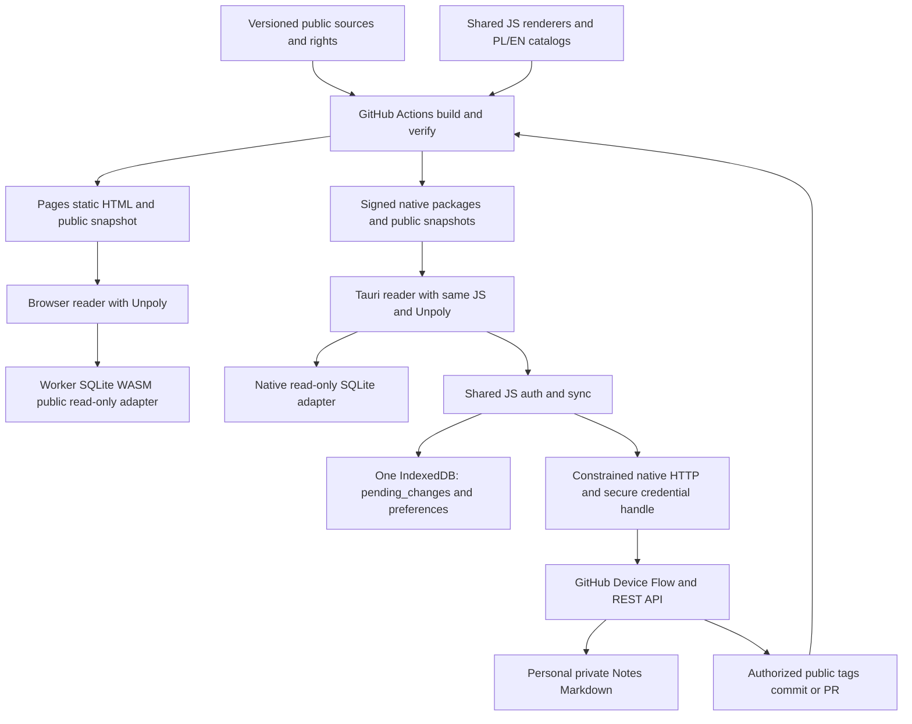
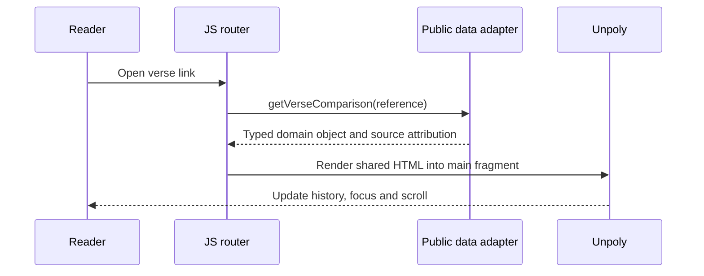
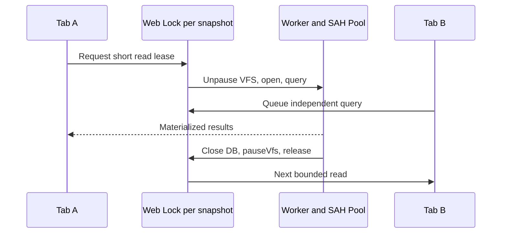
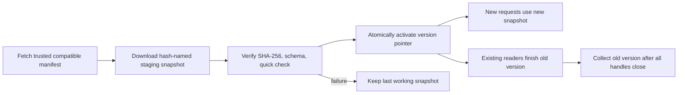

# One application, two delivery environments

Planning decision, 2026-11-18. Nothing in this document is implemented by this change.
See the [actual repository audit](repository-audit.md), [data contracts](data-and-sync.md),
and [release constraints](releases.md).

## Boundary and component diagram

Use JavaScript ES modules, HTML, CSS and Unpoly for one reader. Build-time Node
uses the same JavaScript render functions as the browser and Tauri. Rust provides
only native SQLite, constrained HTTP/credential access and OS integration. No UI,
reference parsing, morphology policy or synchronization business logic moves to Rust.
There is no application server, OAuth broker, Worker, serverless function or private
notes processing in Actions. GitHub itself provides authentication and repository APIs.



The browser is a production read-only product, not a temporarily broken editor.
It does not expose login or private-note controls. Capability flags select native
features inside the shared renderer; they do not create a second UI. Future writable
WWW requires a new reviewed authorization decision and uses the same JS Outbox.

## Rendering, history and navigation

The current [layout](../../KazdyDzienZJezusem/Views/Shared/_Layout.cshtml) uses Unpoly
3.14.3, `up-follow` and `#main-content[up-main]`. Preserve that interaction model.
Unpoly officially accepts local HTML through `content`, `fragment` and `document`;
there is no requirement for ASP.NET to supply it. `up.navigate` applies navigation
defaults, whereas `up.render` needs explicit history/focus options. This is a
documented feasibility result, not an executed offline-history experiment.
([Local HTML](https://unpoly.com/learn/providing-html),
[render API](https://unpoly.com/api/up.render), checked 2026-11-18.)

Proposed JavaScript contracts (illustrations, not files added in this PR):

```js
parseRoute(url, config) // -> { kind, locale, reference, source, query }
routeUrl(route, config) // -> canonical public path, no hash-only routing
renderVerse(viewModel, { uiLocale, textSources, annotationLayers }) // -> HTML
renderChapter(viewModel, preferences) // -> HTML
renderDocument({ fragment, title, description, canonical, alternates }) // -> HTML
navigate(route, { history: 'push', restore: null }) // -> Promise<void>
```

Escape text and attributes at the renderer boundary; sanitize Markdown using one
audited allowlist with raw HTML disabled, protocol checks and no scripts/event
attributes. Unpoly does not sanitize supplied HTML. Package JS/CSS/fonts locally
for offline use instead of depending on the current CDN. Use a restrictive CSP,
no remote scripts and narrowly scoped Tauri capabilities; external links open in
the system browser, never in a privileged WebView.



On an initial Pages load, the HTML already contains real content with JS disabled.
After startup, intercept supported same-origin links, load local data and update the
proper fragment. Before the database is ready, Unpoly may fetch the existing static
HTML fragment. Avoid a full navigation in normal operation. Search without JS has
an honest explanation plus browse links; there is no fictitious server search.

Each tab owns its URL, history entries, verse, selection, filter, scroll, modal and
in-memory annotation choices. Device preferences initialize new tabs; broadcasts
must not overwrite existing tabs' reader state. History entries hold small restorable
view state, never tokens or notes. Modal open/close restores focus. Back/forward must
restore the same source and layers without duplicate event handlers. On Tauri, keep
public path semantics in the JS router, translate external deep links at entry, and
keep a fixed internal origin; do not pretend a custom-scheme URL is a public HTTPS URL.
Direct opening/refresh of nested bundled paths requires an explicit packaging test.

## Public snapshots and multiple readers



Reuse the proven shape in [sqlite-worker.js](../../poc/frontend/sqlite-worker.js),
including missing-file detection, but replace benchmark-sized critical sections with
bounded reads. `db.close()` alone does not free SAH handles. BroadcastChannel only
announces versions/invalidation. Versioned workers reject incompatible manifests;
stale clients get an explicit reload action. No Web Locks or unsupported OPFS means
private per-tab in-memory public SQLite if memory permits, or static read-only HTML
with unavailable search explained. This fallback concerns disposable public data,
never a second Outbox. Test three tabs, aborted imports, suspended workers and quota
errors before declaring support; see [testing](testing-and-ci.md).



Native readers open immutable version files read-only; never overwrite an open file,
especially on Windows. Coordinate activation across processes, retain an older valid
version, and garbage collect only after readers release it. Browser import/activation
uses a metadata lock in addition to the version-scoped read lock, with a fixed lock
order to avoid deadlock. Snapshot replacement never touches pending changes.

## Reader navigation and sketches

Desktop:

```text
Bible | Fathers | Literature | Tags | Search | Application       UI: PL / EN
Translation(s) [TNP UBG KJV TR]    Book [John] Chapter [3]   Layers & languages
< previous       John 3:16 comparison                         next >
TR       Greek source with chosen annotations                    [source rights]
TNP      Polish source                                           [source rights]
UBG      Polish source                                           [source rights]
KJV      English source                                          [source rights]
Tags [name...]                        Native only: [My notes] [Account]
```

Narrow Phosh/mobile:

```text
[Menu] John 3:16                      [Search] [Layers]
[Previous] [Book/chapter] [Next]
TR source and selected annotations
[Word details: form, lemma, Strong, grammar, alternatives]
Translation cards stacked vertically
[Tags]  [Source / license]
Native only: [Note: saved locally / waiting / conflict]
```

Layers panel: separate interface language, Bible sources and annotation languages.
Show the common choices first and an expandable More section. Grammar and pronunciation
have localized help. A word modal preserves exact form, contextual and morphology
glosses, alternatives, uncertainty and provenance. Never imply a dictionary meaning
is an inflected translation or invent a missing gloss.

Native Account: sign-in button → system-browser device authorization → recognized
identity → private Notes readiness → current shared-write status and refresh action.
Return to the same passage. Native Notes: editable Markdown, local-save status,
pending/conflict count, remote refresh, export unsent text and conflict comparison.
An empty cache while offline promises only locally pending notes. Application:
available packages, size/version/checksum, install/update instructions and verified
download/store links; unavailable platforms have an explanation, no broken button.

If local Unpoly navigation proves unsuitable, a future PR must attach a reproducible
failure and timing comparison before replacing it with minimal DOM + History API.
No component framework or XHTML/htmx substitution is justified by this audit.
