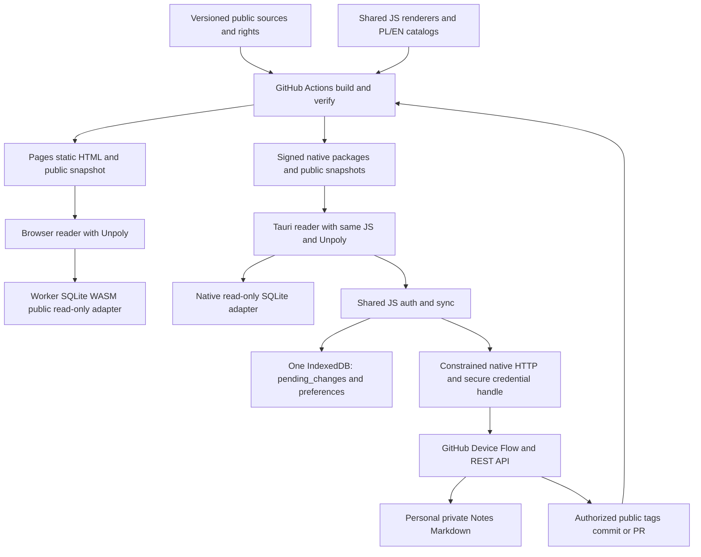
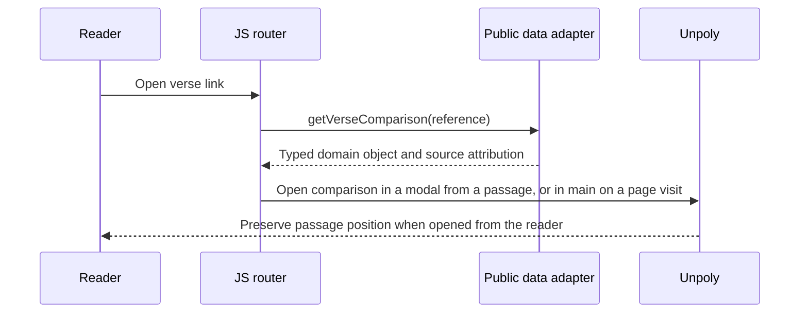
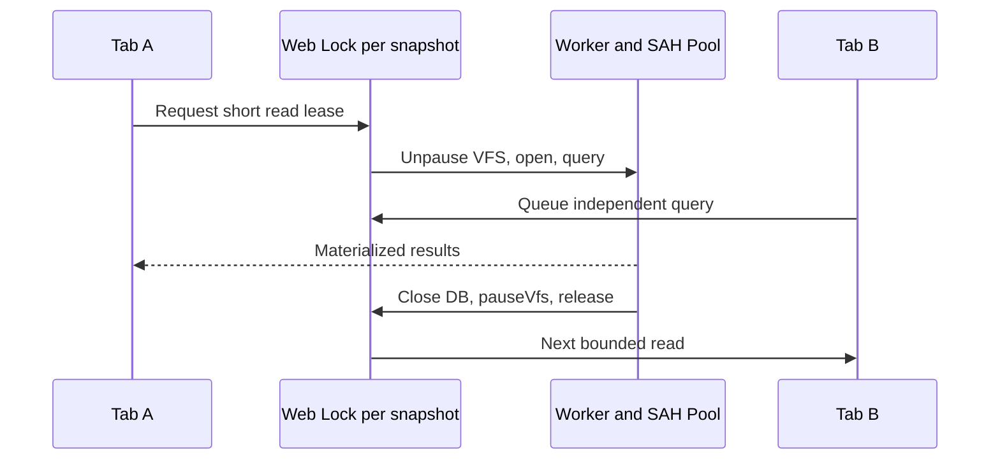
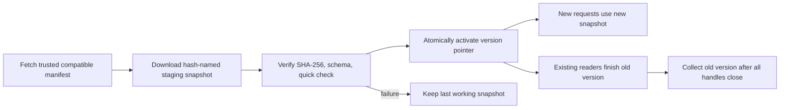

# Didaske on the web and in an installed app

Planning decision, 2026-11-18. Nothing in this document is implemented by this change.
See the [actual repository audit](repository-audit.md), [data contracts](data-and-sync.md),
and [release constraints](releases.md).

## Boundary and component diagram

Use JavaScript ES modules, HTML, CSS and Unpoly for one reader. Build-time Node
uses the same JavaScript render functions as the browser and Tauri. Rust provides
only native SQLite, constrained HTTP/credential access and OS integration. No UI,
reference parsing, morphology policy or synchronization business logic moves to Rust.
There is no application server, OAuth broker, Worker, serverless function or private
notes processing in Actions. GitHub itself provides authentication and repository APIs.



The browser is a production read-only product, not a temporarily broken editor.
It does not expose login or private-note controls. Capability flags select native
features inside the shared renderer; they do not create a second UI. Future writable
WWW requires a new reviewed authorization decision and uses the same JS Outbox.

## Rendering, history and navigation

The current [layout](../../KazdyDzienZJezusem/Views/Shared/_Layout.cshtml) uses Unpoly
3.14.3, `up-follow` and `#main-content[up-main]`. Preserve that interaction model.
Unpoly officially accepts local HTML through `content`, `fragment` and `document`;
there is no requirement for ASP.NET to supply it. `up.navigate` applies navigation
defaults, whereas `up.render` needs explicit history/focus options. This is a
documented feasibility result, not an executed offline-history experiment.
The current Unpoly API documents this behavior for 3.15. Pin the bundled version
in the first renderer PR and run the navigation contract against that build.
[Local HTML](https://unpoly.com/learn/providing-html), [render API](https://unpoly.com/api/up.render).

Proposed JavaScript contracts (illustrations, not files added in this PR):

```js
parseRoute(url, config) // -> { kind, locale, reference, source, query }
routeUrl(route, config) // -> canonical public path, no hash-only routing
renderVerse(viewModel, { uiLocale, textSources, annotationLayers }) // -> HTML
renderChapter(viewModel, preferences) // -> HTML
renderDocument({ fragment, title, description, canonical, alternates }) // -> HTML
navigate(route, { history: 'push', restore: null }) // -> Promise<void>
```

Escape text and attributes at the renderer boundary; sanitize Markdown using one
audited allowlist with raw HTML disabled, protocol checks and no scripts/event
attributes. Unpoly does not sanitize supplied HTML. Package JS/CSS/fonts locally
for offline use instead of depending on the current CDN. Use a restrictive CSP,
no remote scripts and narrowly scoped Tauri capabilities; external links open in
the system browser, never in a privileged WebView.



On an initial Pages load, the HTML already contains real content with JS disabled.
After startup, intercept supported same-origin links, load local data and update the
proper fragment. Before the database is ready, Unpoly may fetch the existing static
HTML fragment. Avoid a full navigation in normal operation. Search without JS has
an honest explanation plus browse links; there is no fictitious server search.

Each tab owns its URL, history entries, verse, selection, filter, scroll, modal and
in-memory annotation choices. Device preferences initialize new tabs; broadcasts
must not overwrite existing tabs' reader state. History entries hold small restorable
view state, never tokens or notes. Modal open/close restores focus. Back/forward must
restore the same source and layers without duplicate event handlers. On Tauri, keep
public path semantics in the JS router, translate external deep links at entry, and
keep a fixed internal origin; do not pretend a custom-scheme URL is a public HTTPS URL.
Direct opening/refresh of nested bundled paths requires an explicit packaging test.

| User action | Fragment and history contract |
| --- | --- |
| Open a chapter | Keep real anchors for direct URLs, copy-link and open-in-new-tab. For an ordinary click, render `#main-content` with the resolved location, localized title and language. Update canonical and alternate links from the route model. Only the newest navigation request may change the screen. |
| Type a search or change a tag filter | Replace only the results region. Keep focus, input and caret across results and cancel stale queries. Restore the submitted query on Back. |
| Open a Greek word or grammar explanation | Render the local detail fragment into an Unpoly overlay. Closing it restores the initiating token, selection and scroll position. A late response for a previously selected token must be ignored. |
| Go back offline | Restore the saved public route and scroll against local SQLite. Exercise the case where no prior fragment remains in Unpoly's cache. Render directly on native history restore, without fetching an HTTP page or pushing another history entry. |
| Change account while Notes are open | Invalidate the account's rendered private fragments and in-flight reads in every window sharing that session. Back and suspended-window restoration must pass the current identity check before rendering private content. Persist only an opaque route ID in history. |

Use a stable element ID and `[up-keep]` for reader controls that should survive
public fragment updates. Language changes must refresh their labels and ARIA
descriptions. Keep Markdown editors scoped to their account and release event
handlers when a fragment is removed. The acceptance driver counts document loads
and tests ordinary clicks, Ctrl/Cmd-clicks, Escape, keyboard focus and two rapid
out-of-order navigation responses. [Unpoly navigation](https://unpoly.com/api/up.navigate),
[layers](https://unpoly.com/api/up.layer), [retained elements](https://unpoly.com/api/up-keep).

## Public snapshots and multiple readers



Reuse the proven shape in [sqlite-worker.js](../../poc/frontend/sqlite-worker.js),
including missing-file detection, but replace benchmark-sized critical sections with
bounded reads. `db.close()` alone does not free SAH handles. BroadcastChannel only
announces versions/invalidation. Versioned workers reject incompatible manifests;
stale clients get an explicit reload action. No Web Locks or unsupported OPFS means
private per-tab in-memory public SQLite if memory permits, or static read-only HTML
with unavailable search explained. This fallback concerns disposable public data,
never a second Outbox. Test three tabs, aborted imports, suspended workers and quota
errors before declaring support; see [testing](testing-and-ci.md).



Native readers open immutable version files read-only; never overwrite an open file,
especially on Windows. Coordinate activation across processes, retain an older valid
version, and garbage collect only after readers release it. Browser import/activation
uses a metadata lock in addition to the version-scoped read lock, with a fixed lock
order to avoid deadlock. Snapshot replacement never touches pending changes.

## Reader navigation and sketches

### Contextual details

On Didaske, every contextual detail opens in a modal first. This applies to TNP
footnotes, verse comparisons, Greek words, morphology, dictionary senses, grammar
help, passage tags and source explanations. The trigger is an ordinary anchor
whose `href` is the detail's dedicated HTML page on the configured Didaske origin.
Plain activation enhances that link to a modal. Opening its link in a new tab,
visiting the URL directly, or following it with JavaScript disabled displays
the full detail as a page. Every modal and every docked panel contains a visible
**Open full page** link to that same URL. Both render the same content, context,
attribution and source-passage return link. The [public URL inventory](seo-and-data-integrity.md)
defines which contextual details have distinct identities.

In Tauri, the full-page action resolves that logical route inside the installed
reader using its bundled renderer and local snapshot. Copying the public link
produces the Didaske HTTPS URL. In the modal, keep focus within the dialog until
it closes or docks. Once docked, expose the detail as a labelled region and
restore keyboard access to the passage. [W3C modal dialog pattern](https://www.w3.org/WAI/ARIA/apg/patterns/dialog-modal/).

| Transition | Reader behavior |
| --- | --- |
| Passage → modal | Keep the passage mounted. Give the dialog a localized title, move keyboard focus inside, trap focus while modal, and support Escape and a labeled Close button. Restore the trigger and its scroll on close. Back closes a modal opened from a passage. |
| Modal → dock | Offer four labeled placements, **Left**, **Right**, **Top**, **Bottom**, usable by touch and keyboard. Move the same detail into a named, nonmodal region alongside the reader. Remove the modal backdrop and focus trap. The reader can scroll, select text, navigate or open another detail while the pinned passage/word remains visible. |
| Dock → another edge or modal | Preserve the detail identity and content scroll. Keep the chapter mounted while reflowing the layout. A subsequent detail opens in its own modal by default. If a dock is occupied, replacing its detail requires an explicit choice. |
| Open full page / new tab | Render the dedicated document with its own heading, permalink and return-to-passage anchor. Back in the originating tab restores the passage and its presentation state. A direct visit has a usable passage link even with empty history. |

Keep the active modal, docked detail and edge in tab-local reader state. Refresh and
history restoration must agree with the recorded passage, selection, locale and
scroll. A separate tab opened from the permalink starts on the standalone detail.
On narrow Phosh screens, support all four positions with independently scrollable
regions, a keyboard-operable boundary size control where necessary, and visible
close/undock controls. Test all edges on portrait and desktop without horizontal
page overflow, hidden controls or losing the reading position. Test the same
transitions offline in Tauri and in both UI languages.

### TNP text and source annotations

Keep the original inline `*`, `**` and other attested TNP markers at their exact
positions. Give every explained marker an accessible localized link name and
bind it to the reviewed note target in its source verse. Multiple occurrences can
point to one note. Preserve each note's own text and internal references. For
source symbols that use a shared legend, link their reviewed explanation.
Render only the EPUB's Jesus-speech spans (`.jq`) in bold, including nested
source markup. Narration on either side stays at the normal weight. Preserve this
distinction in chapters, comparisons, tagged passages and standalone detail
excerpts wherever the TNP text appears, including the first static HTML response.
Locale controls change only the surrounding interface. J 3:16 exercises two
footnote markers inside a single speech range with nested style. J 1:38 exercises
the transition between narration and quoted speech.

Desktop:

```text
Bible | Fathers | Literature | Tags | Search | Application       UI: PL / EN
Translation(s) [TNP UBG KJV TR]    Book [John] Chapter [3]   Layers & languages
< previous       John 3:16 comparison                         next >
TR       Greek source with chosen annotations                    [source rights]
TNP      Polish source                                           [source rights]
UBG      Polish source                                           [source rights]
KJV      English source                                          [source rights]
Tags [name...]                        Native only: [My notes] [Account]
```

Narrow Phosh/mobile:

```text
[Menu] John 3:16                      [Search] [Layers]
[Previous] [Book/chapter] [Next]
TR source and selected annotations
[Word detail modal: form, lemma, Strong, grammar, alternatives]
[Open full page] [Dock: Left | Right | Top | Bottom] [Close]
Translation cards stacked vertically
[Tags]  [Source / license]
Native only: [Note: saved locally / waiting / conflict]
```

Layers panel: separate interface language, Bible sources and annotation languages.
Show the common choices first and an expandable More section. Grammar and pronunciation
have localized help. A word modal preserves exact form, contextual and morphology
glosses, alternatives, uncertainty and provenance. Never imply a dictionary meaning
is an inflected translation or invent a missing gloss.

Native Account: sign-in button → system-browser device authorization → recognized
identity → private Notes readiness → current shared-write status and refresh action.
Return to the same passage. Native Notes: editable Markdown, local-save status,
pending/conflict count, remote refresh, export unsent text and conflict comparison.
An empty cache while offline promises only locally pending notes. Application:
available packages, size/version/checksum, install/update instructions and verified
download/store links; unavailable platforms have an explanation, no broken button.

If local Unpoly navigation proves unsuitable, a future PR must attach a reproducible
failure and timing comparison before replacing it with minimal DOM + History API.
No component framework or XHTML/htmx substitution is justified by this audit.
