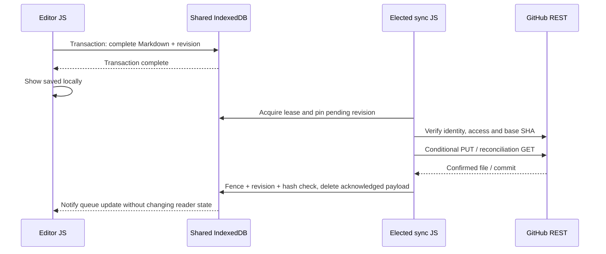

# Public data, pending edits and synchronization

This is a proposed contract, not an implemented schema. The same JavaScript domain modules serve browser and Tauri. Public SQL queries differ only in transport: WASM worker versus bounded native commands. Rust provides SQLite/system/secret transport, not a second reader or notes implementation.

## Sources of truth

| Data | Authoritative storage | Lifecycle |
| --- | --- | --- |
| Public Bible, Fathers, dictionary, interlinear, published tags | Audited source files; reproducible CI-generated `content-<sha256>.sqlite3` | Immutable read-only snapshot, replaced whole after validation; never migrated on device. |
| Confirmed private notes | Plain Markdown in personal private `Notes` | Read on demand into RAM. No default persistent note cache. A future separate disposable per-account SQLite cache requires a concrete measured need. |
| Unsent edits and unresolved conflicts | **One JS IndexedDB Outbox**, `pending_changes` | Commit locally first; remove operation and full payload only after definite remote acknowledgement of that revision. |
| UI language and annotation preferences | `preferences` in the same IndexedDB database | No private Markdown or authentication material. |
| Credentials | Native secure facility/opaque session handle | Never public SQLite, IndexedDB, localStorage, Pages or logs. |

Read-only Pages may initialize preferences but does not initialize/use private pending-change storage. A future approved writable web product must reuse the native product's JavaScript Outbox unchanged. No `outbox.json`, Rust CRUD, second adapter, private table in the public database or persistent mirrored Notes library is planned. Without network and without a disposable cache, only pending drafts and public content are promised offline. A fully synchronized Outbox has zero operations and zero note payloads; that is an acceptance assertion.

## Canonical public schema

Keys below are stable identifiers, not translated labels. Text fields preserve original Unicode and source ordering; `raw_record`/`source_locator` retain otherwise unmodeled source attributes. JSON for original provenance is not a substitute for the indexed fields used by reading and lookup. Every source has an audited redistribution status; unresolved rights block publishing its content. Tables are built with foreign keys enabled and validated before signing/publishing.

| Table and primary key | Required columns / constraints and access paths |
| --- | --- |
| `licenses(license_id)` | Name, authoritative URL, attribution text, version, redistribution decision, territorial/packaging restrictions, evidence date; unresolved is explicit. |
| `sources(source_id)` | Kind, original name, content language, edition/version, source URL, input SHA-256, license ID, attribution, original metadata JSON. Never infer edition equivalence from language. |
| `books(book_id)` | Stable canonical code and display order; identifiers independent of UI locale. |
| `book_names(book_id,locale,alias)` | Canonical display name/abbreviation flag and legacy aliases. Alias collisions are explicit validation failures, not silently overwritten. |
| `source_books(source_id,book_id)` | Source-specific book order and source name. TNP's actual 47-book coverage remains intact. |
| `verses(source_id,book_id,chapter,verse)` | Original text, source locator, raw record, display order; integer chapter/verse ranges validated against the source. Composite reverse index `(book_id,chapter,verse,source_id)` for comparison. Missing translations are absence, not empty invented verses. |
| `verse_runs(source_id,book_id,chapter,verse,ordinal)` | FK to the source-specific verse. Ordered rich-text or annotation occurrence with original XHTML locator, source kind/classes, literal text or marker, presentation text, ordered inherited style roles, and optional `note_ordinal`. Note references have a composite FK to the footnote in that same verse/edition. |
| `verse_footnotes(source_id,book_id,chapter,verse,note_ordinal)` | FK to the source-specific verse. A distinct publisher explanation with source label, original body text, original language, ordered body runs, locator/range within the original comment block, attribution and license. Multiple marker occurrences can address one note. |
| `fathers_works(work_id)` | Source ID, author ID/name, work slug/title, source order, raw metadata. |
| `fathers_passages(work_id,chapter,ordinal)` | Original paragraph/reference marker and text, locator, order; **chapter zero is valid** for existing Fathers material. |
| `tags(tag_id)` | Unique stable slug, title, Markdown description, original Markdown, source repository ID/commit/path, display order and license/provenance. |
| `tag_ranges(tag_id,ordinal)` | Original fragment expression, target kind, parsed book/work/start/end and validation status; preserve input rather than replacing a range with generated text. |
| `tag_verses(tag_id,book_id,chapter,verse)` | Fully expanded Bible membership, reverse index `(book_id,chapter,verse,tag_id)`; each target must exist in at least one source. |
| `tag_fathers(tag_id,work_id,chapter,ordinal)` | Expanded Fathers membership, reverse target index. This is needed for existing Ignatius/Ef0,1-style references, not just Bible tags. |
| `dictionary_entries(entry_id)` | Source ID, original entry ID/Strong code (nullable), original lemma, lemma search key, original definition/meaning, raw record, license attribution. Index `(source_id,strong_code)` without inventing Strong codes for other sources. |
| `dictionary_forms(form_id)` | Source ID, original surface spelling, exact `form_key`, relaxed `alignment_key`, locator/raw record; index `form_key` preserves distinct originals that normalize to the same key. |
| `form_senses(form_id,ordinal)` | Entry ID nullable, Polish inflected gloss nullable, English text, English kind (`gloss`/`dictionary`), original grammar, grammar code, pronunciation, lemma/source attribution; retain all alternatives and their order. |
| `interlinear_tokens(source_id,book_id,chapter,verse,position)` | Original Greek, exact/relaxed keys, original source token ID/raw record. Independent editions have independent source IDs; positions must be continuous within each passage. |
| `token_annotations(source_id,book_id,chapter,verse,position,layer,locale,ordinal)` | Value, entry ID/Strong code nullable, grammar code nullable, provenance source ID and raw annotation; one-to-many gloss, grammar, pronunciation, lemma and alternative layers. Missing layers are absent. |
| `grammar_codes(code)` | Namespaced key `<notation-system>:<raw-code>` prevents collisions between grammar conventions; parsed grammatical attributes and canonical meaning keys plus original notation. Localized help is catalog-driven; unknown codes preserve raw values and expose an explicit unknown state. |
| `search_documents(doc_id)` | Integer primary key used as FTS rowid. Explicit `kind`, `source`, `ref`, `pl`, `gr`, `en`, `lemma` columns plus original-target key and normalization version; doc ID is deterministically allocated from the ordered kind/source/reference key. Build from the normalized tables. |
| `docs_fts` | FTS5 external-content index on `search_documents`, same rowid mapping; `source`/`ref` unindexed, searchable language/lemma columns. Fixed tokenizer configuration in manifest. |

Relational relationships: sources→licenses; verses→source_books; work/passages→sources; forms/senses/entries→sources; annotations→their exact token; range expansions→their tag and valid target. Token coordinates reference the union Bible reference set, **not** a requirement that the same source has a row in `verses`: a dictionary/interlinear edition is not necessarily a Bible translation. Strong occurrence source and interlinear source must not be zipped together by position. The audit finds 137,323 aligned interlinear token occurrences versus 140,628 independent Strong-source occurrences; their distinction survives export and tests. Cross-edition alignment, where supplied, is explicit annotation provenance.

Use a deterministic build-only `meta(key,value)` table for schema version, generator version, normalization version, corpus digest and source manifest digest. Runtime does not run `CREATE`, `ALTER`, SQL migrations or ad hoc SQL from UI. CI builds tables, indexes, FTS and manifests from the existing source files without duplicating the entire corpus into a new Git tree. See [independent golden reference mapping](seo-and-data-integrity.md).

## Importing source-marked verses and footnotes

At build time parse the pinned TNP EPUB book XHTML against its edition stylesheet and resolve each `vC.V` to the same verse key as the existing YAML. Preserve the original verse fragment or a byte-resolvable locator and checksum in the verse's source record, including the complete `.ct` block. Enumerate inline text nodes in document order, with their exact original code points, whitespace and ancestry. End a style at its element boundary: a child's XML tail inherits the parent's styles. Derive `jesus_quote` only from source `.jq`, including text nested within it. Preserve other roles, e.g. `.df` for added words. Render `jesus_quote` with bold weight in both locales in every view that quotes this verse. Source-specific semantics stay on the TNP translation row. Never infer the speaker of an unmarked verse or project TNP ranges onto another edition.

Classify inline `.ca` occurrences separately from the text channel and bind them to validated labels/body ranges in the same verse's `.ct`. A literal `*` is a focusable link. Keep the number of stars and placement of each printed marker, including repeated markers. Non-star `.ca` annotations retain their literal label and mapping. Store `.rf` links and `.st` codes with their original values and locators as separate source annotation runs. Only text-channel runs contribute to the legacy plain-text projection used for search/legacy comparisons. Apply the approved soft-hyphen and whitespace normalization to the entire ordered projection, preserving spaces across inline boundaries. The archived source and original run data remain available for verification.

Assign each distinct explanation an edition-scoped, stable verse-local ordinal and retain the source locator of each incoming marker. A repeated marker may share a target. Parse source conventions including nonbreaking spaces and inline textual references to other notes. Neither equal counts, splitting at every asterisk or semicolon, nor pairing by document position alone establishes the mapping. Validate each mapping against the independent reference. For an ambiguous marker preserve the intact source block and literal marker, report the exact verse/locator, and require a reviewed source-specific mapping before publishing the requested clickable edition. Preserve existing identifiers across corpus revisions. Review a changed target explicitly before reassigning a public detail URL.

`getChapter`, `getVerseComparison` and tag passage reads return the same `runs` representation. Example fragments from J 3:16 are a text run with `styles: ['jesus_quote','added_text']` and a marker run with `kind: 'footnoteRef', marker: '**', noteOrdinal: 2`. An activated marker resolves its own source-specific note via `getVerseFootnote`. Static generation and Tauri use the same identifier. Each full footnote URL works directly. Inside the enhanced reader the detail component offers its full-page link while keeping the originating verse and preferences available. The original Polish body, its attribution and its links render from the immutable public snapshot.

Verify every run's order, raw/presentation text, style roles and every note body/target FK against the reviewed ZIP. Check the decoded source span boundaries separately from the flattened projection and FTS. Fixture regressions include a missing second star in J 3:16, note bodies swapped, a quote extended into narration in J 1:38, a lost nested style, a new note inferred from an asterisk in a body and lost repeated references in Rt 2:4. Include the richer data in snapshot byte/hash budgets and test the no-JS note targets against the complete approved note inventory. [Source fixtures and measured counts](repository-audit.md)

## Preserve Greek semantics rather than replacing lookup with FTS

[GreekInterlinearService](../../KazdyDzienZJezusem/Services/GreekInterlinearService.cs) currently distinguishes exact-form lookup and relaxed passage alignment. Preserve these rules in shared JS with fixtures drawn from the current C# tests:

* `form_key`: lowercase, Unicode NFD, grave U+0300→acute U+0301, NFC, final sigma→sigma. Breathing marks, diaeresis and iota subscript remain significant.
* `alignment_key`: strip combining nonspacing marks from the decomposed form key. This is only for alignment/search, never the displayed spelling or definitive morphological identity.
* Align passage tokens using the existing longest-common-subsequence tie behavior; accept passage glosses only when aligned length is at least `min(3, selectedWords)` and at least 65% of selected words. Preserve repeated-token ordering and selection context, not just a bag of FTS matches.
* A relaxed-aligned spelling cannot supply pronunciation if its exact form key differs. Use the exact-form fallback or show unavailable pronunciation.
* Form ambiguity remains an explicit alternatives list; English lemma/dictionary meaning is labeled as such and never silently substituted for a Polish inflected gloss. Missing forms remain missing.

[GreekDictionaryRepository](../../KazdyDzienZJezusem/Services/GreekDictionaryRepository.cs) validates parallel arrays, declared counts, required pronunciation and supplement provenance. Supplements fill **missing** forms; they do not override aligned corpus entries. Preserve these validations, source labels and unknown metadata. The POC FTS corpus's 22,815 dictionary records are not interchangeable with production's 21,264 normalized form keys. Its normalized search strings cannot reconstruct original interlinear tokens.

The separate Strong mode first aligns the selected words to the source **at the requested reference**. An aligned token must also have the same exact form key, a Strong ID and a grammar code. Derive a SQL index on attested (source, Strong ID, grammar, exact form). Exclude spellings with multiple Strong identities for the same grammar. Take up to 32 compatible forms, actual spelling first, then ordinal order. Keep Polish glosses with the matching grammar among the source's slash-separated codes. Group nonempty candidates case-insensitively, rank by frequency then ordinal spelling, and return `unavailable`, `missing`, `single` or `variants` as today. Preserve the full original definition for integrity checks even if the modal truncates its preview. Compare candidate order, exact-form mismatches and ambiguous identities with the current service. [GreekMorphologyService](../../KazdyDzienZJezusem/Services/GreekMorphologyService.cs)

Tests compare composed/decomposed accents, grave/acute, smooth/rough breathing, sigma variants, ambiguous forms, repeated words, wrong reference, sub-threshold context, pronunciation differences, missing terms and each supplement's priority. Full data checks compare originals separately from FTS keys. A UI locale change must not change these matches.

## Read adapter and domain contracts

All operations return Promises with structured values and a common error `{code, messageKey, details, retryable}`. Codes include `NOT_FOUND`, `INVALID_REFERENCE`, `DATA_UNAVAILABLE`, `UNSUPPORTED_SCHEMA`, `CANCELLED`, `STORAGE_FULL`, `AUTH_REQUIRED`, `PERMISSION_DENIED`, `CONFLICT`. Human text comes from PL/EN catalogs. Callers supply abort signals; responses include snapshot version so a stale response cannot overwrite a newer navigation.

```js
data.getTranslations({ signal })
data.getBooks({ sourceId, signal })
data.getChapter({ sourceId, bookId, chapter, signal })
data.getVerseComparison({ bookId, chapter, verse, sourceIds, signal })
data.getVerseFootnote({ sourceId, bookId, chapter, verse, noteOrdinal, signal })
data.getFathersChapter({ workId, chapter, signal })
data.listTags({ cursor, signal })
data.getTag({ slug, preferredTranslation, signal })
data.getTagsForFragment({ kind, reference, signal })
data.getGreekAnnotations({ text, context, reference, layers, signal })
data.getGrammarHelp({ code, uiLocale, signal })
data.getDictionaryEntry({ entryId, signal })
data.search({ query, sourceIds, layers, cursor, limit, signal })
data.getDataVersion() // { schemaVersion, contentHash, normalizationVersion }
notes.getNote({ accountId, noteId }) // pending overlay, otherwise remote/RAM
notes.listNotes({ accountId, cursor, signal }) // unions remote listing and pending overlays
notes.saveNote({ accountId, noteId, markdown, expectedLocalRevision, baseSha })
notes.syncPending(accountId)
```

For a request limited to `sourceIds: ['TR', 'KJV']`, a comparison result is `{reference:{bookId:'J',chapter:1,verse:1}, dataVersion:'sha256:…', translations:[{sourceId:'TR',lang:'grc',text:'…',licenseId:'…'},{sourceId:'KJV',lang:'en',text:'…',licenseId:'…'}], unavailableSourceIds:[]}`. Original corpus book IDs are mapped explicitly in the generator; the example is a domain identifier, not a claim that source filename codes equal it.

`browser-db.js` and `tauri-db.js` implement only fixed operations using parameterized SQL and bounded limits (proposed search maximum 100, deterministic keyset cursor). JS owns reference validation/navigation/grammar semantics. Rust repeats boundary/size validation as defense in depth and executes predefined SQL; neither exposes `executeSql(sql)` to a view. Contract fixtures exercise identical values, ordering, pagination, errors and cancellation on both adapters.

For example, `getTag` returns the original Markdown description, ordered ranges, resolved passages and unavailable-range markers. Honor the preferred source only when it covers the full range. Apply the current default/fallback rules in [TagPassageReader](../../KazdyDzienZJezusem/Services/TagPassageReader.cs). A search cursor carries snapshot hash, query/filter identity and final sort keys. Reissuing an old cursor against a new snapshot returns a restartable page-one state. Build literal FTS terms from bounded user text, preserve source filters separately and bound work on the adapter. Reuse the POC's `unicode61 remove_diacritics 2` tokenizer for the first parity comparison, with original spellings retained for display. Include punctuation, accents, empty input and stable tied ranks in contract fixtures. [Current search index](../../poc/build_sqlite.py)

## Immutable snapshots and multiple readers

The signed/content-verified manifest contains schema/version, full SHA-256, compressed/uncompressed sizes, source manifest hash and minimum compatible app version. The browser verifies downloaded compressed and decompressed integrity as specified; Tauri verifies before opening. A hash served alongside arbitrary tampered content is not authenticity: deliver manifests from the trusted release/static origin and use release-signed metadata where downloaded independently. Downloads have size ceilings and abort cleanly.

Native: unpack to a temporary file beside the app's data directory, verify complete digest/schema/quick check, open with SQLite read-only flags (not merely POC `query_only=ON`), then atomically switch a small active-version pointer under a cross-process update lock. Readers pin the immutable hash they opened. Existing readers may finish on that hash; do not overwrite their file. Windows handles must close before deletion. Garbage collection removes an old version only when no process owns a reader and a rollback copy is retained. A crashed owner's lease expires conservatively; failed verification, low disk or activation keeps the previous active version. A rollback changes the pointer to a compatible existing snapshot, not user data. Upgrade never touches IndexedDB.

Browser: retain the tested ownership/release pattern in [sqlite-worker.js](../../poc/frontend/sqlite-worker.js), then version the OPFS SAH pool and lock by origin/content hash. Under a short exclusive Web Lock: initialize/unpause VFS, open/import/read, close SQLite and **pauseVfs() in finally**, then release. Closing the DB alone does not release SAH handles. Reset/import and reads share the same lock; old readers continue against the old version until their request finishes. BroadcastChannel announces available versions but is not a mutex and never changes another tab's verse/scroll. Give queued reads a bounded deadline, cancellation and a delayed waiting indicator; on crash, wake/retry rather than an infinite spinner. Avoid holding any lock while a user is interacting with a modal.

If OPFS/SAH or Web Locks are absent, use a read-only WASM in-memory snapshot per tab, subject to memory limits. This sacrifices retained public cache, not data correctness; never bypass coordination around a shared SAH pool. Static HTML remains useful if WASM or memory allocation fails. Pixel native uses Rust SQLite: its lack of OPFS says nothing about IndexedDB. Tests cover cold `NotFoundError`, simultaneous import/reset, crashed/suspended workers, stale manifests and old workers resuming after a new version activates.

Allocate a distinct SAH pool **directory and VFS name** per content hash. A per-hash Web Lock with two workers still pointing at the default pool directory would leave both workers contending for the same handles. Fetch outside the lock. Stage and validate under the new hash's lock, release all VFS handles, then take the short manifest lock and conditionally activate only if the observed predecessor is still current. After a failed CAS reread the active version. A slower download must never downgrade another tab. When a reader meets a collected version, reopen against the active version and retry the bounded query. Guard cleanup by the same locks and recheck the active and rollback hashes. [SQLite SAH pool options and concurrency](https://sqlite.org/wasm/doc/trunk/persistence.md)

## One IndexedDB Outbox

Freeze one database name and technical version at the first writable release. Native origin/profile is stable across updates. Proposed technical stores are `pending_changes` (key `[accountId, operationId]`, indexes by account/status and account/repo/path), `sync_leases` (key `accountId`) and `preferences` (key `[scope,key]`). JSON payloads evolve with optional fields, not recurring database migrations. A read-only Pages profile can begin with preferences only; any future addition of stores is an explicit tested IDB version upgrade, never a database reset.

```js
{
  accountId: 12345, operationId: 'uuid', formatVersion: 1,
  kind: 'note-upsert', // note-delete | public-tag-update
  repositoryId: 67890, path: 'kdzj/notes/<uuid>.md', branch: 'main',
  markdown: 'Complete unsent UTF-8 Markdown',
  baseSha: 'remote-blob-sha-or-null', baseMarkdown: 'merge base if needed',
  payloadHash: 'sha256-of-exact-intended-bytes', revision: 3,
  state: 'pending', // conflict; blocking/retry reason is metadata
  createdAt: 'ISO timestamp', updatedAt: 'ISO timestamp', attempts: 0,
  notBefore: null, blockedReason: null,
  conflict: null // when needed: current remote SHA and full remote/local variants
}
```

Base/remote text retained for an unresolved operation is part of that operation's recovery payload; delete it together with the operation after acknowledgement. Never keep completed operations as a durable audit history. `note-delete` retains enough base content for recovery/conflict display until confirmed. Preferences and leases may keep non-content identities/timestamps but not note text or a mirrored file index.

Proposed methods: `enqueue(operation)`, `getPending(accountId)`, `updatePending(key, expectedRevision, patch)`, `removeAcknowledged(key, revision, payloadHash, proof, fence)`, `getConflicts(accountId)`, `acquireSyncLease(accountId, ownerId)`, `renewSyncLease(...)`, `releaseSyncLease(...)`, `exportPending(accountId)`. Every mutating method is one short `readwrite` transaction and resolves only on **transaction completion**, not the individual request's success. Request strict durability where supported, handle rejection/abort and verify actual behavior on each engine; strict is a durability hint, not a universal power-loss guarantee. [IndexedDB durability](https://developer.mozilla.org/en-US/docs/Web/API/IDBTransaction/durability)

A draft is visibly **saved locally** only after completion. Quota, permission, private/incognito mode, failed open, `blocked` or `versionchange` produce an explicit unsaved/recovery state, retain the editor text in memory and offer immediate user export. Do not claim the memory copy survives exit. Request persistent storage where available in future writable WWW; persistent storage does not survive user-directed clearing. localStorage is unsuitable as the sole copy. Eviction and profile removal remain documented risks, not solved by adding another undocumented file. [Quotas/eviction](https://developer.mozilla.org/en-US/docs/Web/API/Storage_API/Storage_quotas_and_eviction_criteria)

## Transactional writer ownership and acknowledgement

Multiple windows edit a shared Outbox without sharing reader navigation. Web Locks can elect a synchronizer while its network batch runs, but no IDB transaction stays open during network I/O. A transactional lease in the same IDB protects environments/processes where Web Locks do not span all participants. Acquisition checks expiry and increments a monotonically increasing generation/fence. Renew before dispatch, use conservative TTL plus bounded requests, stop dispatch on lost ownership, and validate fence again inside every mutation/ack transaction. BroadcastChannel is notification only. Clock jumps, suspended processes and expired ownership are test cases; elapsed wall time alone is never authority for deleting a row.

A lease fence protects **local** mutations; GitHub does not accept that fence. Therefore every remote mutation also uses its SHA/parent precondition. An expired owner can have a request already in flight; the new owner reconciles it before sending a competing payload. Remote effect verification and user-visible conflicts preserve safety even when duplicate delivery occurs. Never advertise mathematically exactly-once transport.

Keep the last generation in `sync_leases` even when the owner releases it. In one transaction, release only the matching (account, owner, generation) and mark that lease vacant. The next acquisition increments the stored generation. This prevents a late acknowledgement becoming valid again after a release/reacquire cycle. Serialize edits by logical target (account, repository, branch, path) as well as by operation UUID. Find or create its pending operation in the same transaction as the revision check, including the first save. Preserve a racing editor's different text as an unresolved conflict with its own revision. Test two windows saving the same previously synchronized file with no local pending row and repeat with a stale acknowledgement after lease release. [IndexedDB transaction scheduling](https://www.w3.org/TR/IndexedDB-3/#transaction-scheduling)

1. Local save uses expected revision CAS. Two windows editing the same local revision do not silently overwrite each other: the losing save retains a conflict/copy for resolution. A sync attempt pins operation ID, revision, payload hash, base SHA and fence in memory.
2. Outside the transaction, inspect remote identity/visibility/access and current file. If current content already equals the intended bytes, acknowledge only that pinned revision after proving the right repo/path/branch. If current equals the base, PUT with current blob SHA. A differing remote version invokes a safe semantic merge or conflict; arbitrary Markdown uses explicit comparison rather than automatic last-write-wins.
3. A successful response supplies file/commit identity; a lost response triggers reread. Exact desired bytes in the right repository are adequate proof of an idempotent upsert. If remote advanced again, inspect relevant commit history where possible; otherwise retain a conflict instead of guessing. For deletion, an absent file counts only after proving repository access and absence at the intended branch; an authorization 404 does not.
4. In a new IDB transaction, remove only if operation ID/revision/hash and current lease fence still match. Delete its full recovery payload. If the user saved revision 4 while revision 3 uploaded, **do not delete revision 4**. Reconcile the observed remote SHA into its base only when lineage proves revision 4 extends revision 3, retain its full text and remove acknowledged predecessor content; otherwise mark conflict.
5. If the acknowledging worker lost its fence, it performs no local mutation. The next owner rereads GitHub and reaches the same conclusion. Crash after remote acceptance but before local deletion is recoverable. Crash after transaction completion leaves the remote canonical note and no local pending payload.

For tags, the immutable snapshot can lag GitHub. Pending preview is window-local and labeled unsent; acknowledged-but-unpublished state is fetched from GitHub/RAM and labeled awaiting publication. It must not turn the Outbox into a permanent completed-operation store. Workflow publication failures do not cause a second upload of an already accepted tag.



## Markdown interoperability and recovery

Notes use UTF-8 `.md` under `kdzj/notes/`. A new note may have optional YAML front matter with `id`, `created`, `updated` and `references`, followed by ordinary Markdown. Preserve unknown keys, comments and formatting when editing known metadata; prefer retaining raw front matter rather than parsing and reserializing the whole document. A file created manually on GitHub without front matter is valid: derive its stable local identity from repository ID/path until explicitly assigned an ID. Reject unsafe paths and unsupported file modes, not ordinary Markdown.

Fetching remote updates refreshes RAM while preserving pending overlays. Edit/edit and edit/delete conflicts show base/local/remote text and retain both versions until a resolution is saved and acknowledged. **Keep both** may create a new UUID Markdown file in the same Notes repository with an explicit user decision. Explicit discard requires confirmation/export opportunity; never equate logout with discard. Switching accounts clears visible/private RAM and secret handles but leaves that account's pending partition intact. Reinstallation/profile deletion can destroy IDB: warn/export before a user-requested destructive action; no architecture can promise to survive arbitrary user deletion without an external copy.

On start, focus, reconnect or manual refresh, verify the active account and private repository, resolve the current head, and enumerate regular Markdown files beneath the agreed namespace from its Git tree at that commit. Descend into subtrees on a truncated response. Reuse unchanged blob SHAs from account-scoped RAM, fetch changed bodies on demand, and overlay pending upserts/deletes. A file added directly on GitHub appears without an app-generated index. A remote deletion of a clean file removes it from the list. A rename arriving while the old path has a local draft requires reconciliation before creating any replacement. Ignore late fetches after identity changes. Test discovery of a newly created, moved and deleted Markdown file alongside a pending offline edit. [Git Trees API](https://docs.github.com/en/rest/git/trees)

Export is a user-triggered downloadable JSON envelope plus optional Markdown files containing account/repository IDs, operation IDs, revisions, base SHAs and payloads. It is a recovery artifact, not an automatic second Outbox. Import validates schema/path/size, shows target account, deduplicates UUID/revision/hash and reconciles against GitHub before sending; do not auto-assign an export to the currently logged-in account.

## Platform proof required before writable release

The same origin does not prove the same profile. Freeze product identifier, actual origin/scheme, profile paths and sandbox application ID independently from public repository naming. In particular, changing Tauri `useHttpsScheme` changes the IndexedDB location on Windows/Android. [Tauri configuration](https://v2.tauri.app/reference/config/)

In Tauri's JS API, a custom `dataDirectory` is resolved relative to the WebView label. Two different labels with the same relative option can therefore select different storage. First measure the default persistent profile. If explicit configuration is needed on desktop, configure one stable path through the Rust WebView builder and compatible WebView2 settings. WKWebView supports an explicit `dataStoreIdentifier` from iOS 17 or macOS 14. On older supported versions, measure the default persistent data store. Android does not expose those desktop controls. Record the actual origin, identifier and observed cross-window reads on each target, including Flatpak's app-scoped profile. [WebView configuration](https://v2.tauri.app/reference/javascript/api/namespacewebview/)

Run the following future experiment on real Pixel/Phosh/Alpine and Flatpak aarch64, Linux Mint x64, X13s Ubuntu ARM64, Windows WebView2, Android WebView and iOS WKWebView; browser tests use Chrome, Firefox and Safari with three tabs. Publish exact hardware, OS/engine, app/profile/origin, test commands, screenshots and PASS/FAIL for each row:

| Proof | Required observation |
| --- | --- |
| Open, put, immediate process kill/relaunch; OS reboot | A transaction-confirmed complete payload and its identifiers survive; no false saved state. |
| App build 1→2; WebView/runtime and Flatpak sandbox upgrade | Same queue and identity; public snapshot can be replaced or rolled back independently. |
| Two windows and two real processes write/edit/sync | Both see the same database; CAS/fencing rejects stale mutations; no missing/duplicate user edits. Engine profile locking is tested, not assumed. |
| Old owner suspended past TTL; network request completes late | No loss of newer payload; conditional remote operation reconciled; stale local ack refused. |
| Offline→online; logout→login; A→B→A | Correct isolation, retry after start/focus/online, no pending deletion on account changes. No claim of sync while closed. |
| Storage full/eviction/private mode; blocked version change | Explicit unsaved warning and recovery/export; cannot silently report durable success. |
| Stub remote accepts but connection drops | Next run confirms SHA/content; only the acknowledged revision disappears; queue is empty after complete sync. |
| Same note edited manually on GitHub | Remote change visible; simultaneous local change yields preserved conflict and PL/EN comparison UI. |

If shared profiles or durability fail, that target's writable release is **blocked**. First test supported stable-profile configuration. If it still fails, publish the evidence and propose a minimal owner-approved alternative (for example limiting one running instance while retaining multiple windows, if acceptable). Do not quietly add file storage, second Outbox or claim independent processes work. Read-only use may continue if clearly scoped; it does not satisfy the writable target's acceptance gate.
